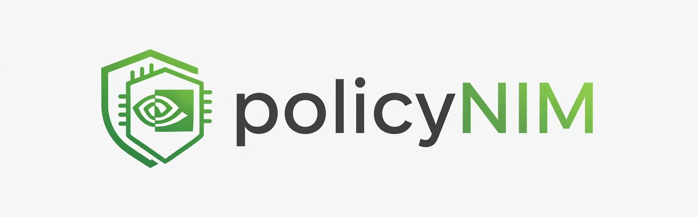
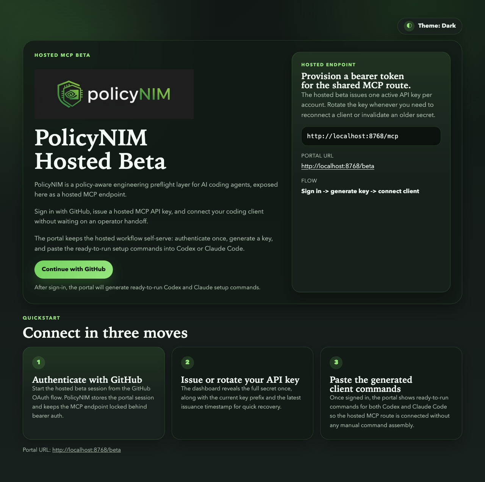

# PolicyNIM

<p align="center">
  <picture>
    <source
      media="(prefers-color-scheme: dark)"
      srcset="src/policynim/assets/beta/policynim_darkmode.jpg"
    >
    
  </picture>
</p>

[](https://docs.nvidia.com/nim/)

PolicyNIM brings a team's reviewed engineering policies into coding-agent workflows.
Choose policy packs, add project rules, review replacements, and publish a version
that keeps sources, citations, vectors, and runtime rules together.

Agents receive complete selected policy bodies with their conditions and exceptions.
PolicyNIM refuses output when source ownership or exact references can't be validated.
Its local runtime wrapper can allow, require confirmation for, or block supported
actions according to explicitly declared rules, then retain execution evidence.

PolicyNIM ships with three user-facing surfaces:

- a JSON-first CLI for local developer workflows
- an MCP server for integrations such as Codex and Claude Code
- a private local setup UI for policy selection, vector storage, and a verified first result

## What The Policy Logic Controls

- **Which rules are effective:** pinned packs and reviewed additions, exclusions,
  replacements, and declared conflicts define the selected policy set.
- **Which source supports a result:** whole selected policies retain their original
  conditions, exceptions, owner metadata, and source coordinates.
- **Which version was used:** a complete generation binds policy text, its index,
  and runtime rules; readers retain that version during updates and rollback.
- **What a declared runtime rule does:** command, path, and HTTP-host matchers
  produce allow, confirm, or block decisions for actions submitted through the wrapper.
- **What actually happened:** execution evidence records the decision, confirmation,
  outcome, and generation. Review applicability and source trust before acting.

See the [policy lifecycle and worked migration example](docs/policy-lifecycle.md).

## Choose Your Policies And Storage

PolicyNIM 0.3.0 adds browser setup and configurable vector storage. Install or
upgrade the Python package with `uv tool install --python 3.11 --upgrade 'policynim>=0.3.0'`.
For PostgreSQL, install its optional driver before opening setup:
`uv tool install --python 3.11 --upgrade 'policynim[vector-postgres]>=0.3.0'`.

```bash
policynim setup
```

The loopback-only UI previews policy packs, checks database connectivity, builds a
complete generation after consent, verifies a policy-backed task, and saves a new
private config file. Existing config files are preserved.

SQLite is the default. Bring your own Qdrant server or PostgreSQL database with
pgvector. PostgreSQL needs the optional `vector-postgres` extra. External databases
hold a derived vector replica; the sealed local generation remains the source
authority and retains vectors for validation and recovery. Open-source database
software, infrastructure costs, and NVIDIA service usage have separate boundaries.

[Setup and privacy](docs/local-onboarding.md) · [Vector backend configuration](docs/vector-storage.md)

## What Works Today

- Deterministic Markdown ingest with heading-aware chunking and source line spans.
- Ingest-time compilation of `runtime_rules` frontmatter into the persisted runtime rules artifact.
- NVIDIA-hosted embeddings and reranking for retrieval.
- Local sqlite-vec storage for the retrievable policy index.
- Opt-in Qdrant and pgvector retrieval with generation-bound replicas and explicit synchronization.
- Task-aware policy routing with citation-preserving selected-policy packets.
- Source-extractive policy compilation and preflight: models select compact IDs,
  then services quote whole pinned policy bodies with canonical citations.
  [Output semantics and limits](docs/source-extractive-guidance.md) describe the
  empty advisory fields, source budgets and required applicability review.
- Opt-in preflight evidence traces that link chunks, selected policies, compiled
  source quotations, and conformance checks.
- Opt-in policy-backed regeneration for preflight and eval preflight cases,
  reusing the same compiled packet and typed conformance failures as retry
  triggers. Repeated attempts retain the same quoted source set; they can't
  rewrite policy text or establish a policy repair.
- Eval backend selection with optional policy-conformance scoring for compiled
  plans and preflight outputs, with compact traces embedded in eval result
  artifacts and local Phoenix reporting for non-headless runs.
- Runtime-rule decisions plus SQLite-backed evidence for allowed, confirmed,
  blocked, and failed runtime actions.
- Interactive `init`, `quickstart`, and `doctor` setup plus JSON-first CLI
  commands for `ingest`, `dump-index`, `search`, `route`, `compile`,
  `preflight`, `eval`, `mcp`, `mcp-config`, `mcp-smoke`, `support-bundle`,
  `beta-admin`, `runtime`, and `evidence`.
- MCP tools for `policy_search`, `policy_compile`, `policy_preflight` and
  `policy_preflight_evidence`, with versioned policy resources and a review prompt.
- Hosted HTTP `streamable-http` with `/healthz`, a self-serve `/beta` portal,
  and bearer auth on `/mcp`.

The MCP server supports protocol `2026-07-28` and legacy clients through the
official Python SDK `2.2.0`, with typed tool outputs and stateless HTTP. Set
`POLICYNIM_MCP_MAX_CONCURRENT_OPERATIONS` to bound expensive tool calls per server
(default `10`). Excess calls receive a retry-later error. See the
[MCP workflow](docs/workflows.md) for transport and public-origin configuration.
For evaluations that need to survive client disconnects, see [durable evaluation jobs](docs/evaluation-jobs.md).

See [grounded MCP guidance](docs/grounded-mcp.md) for tool schemas, evidence and
immutable resource links.

The maintained source baseline includes application-security and MCP trust guidance
with pinned references, role boundaries, and authored scenarios. See the
[coverage matrix and source licenses](docs/security-mcp-coverage.md). Policy text
has source-specific notices; software licensing remains separate. Source contents
don't establish the hosted service's indexed generation.

## Inspect Policies Without An API Key

Policy inventory commands work without a provider API key. From a source checkout:

```bash
uv run policynim policies list --source
uv run policynim policies show SEC-AUTH-001 --source
uv run policynim policies validate --source --format json
uv run policynim inventory --format json
```

These examples inspect mutable sources with `--source`. Without that flag, catalog
commands inspect the active generation when one exists.

The catalog commands list policy IDs, source text, pack versions, and content
revisions. Inventory inspects the selected Markdown sources and local SQLite index
without setup, model credentials, network calls, or data changes.
Source documents, source chunks, indexed policy IDs, and indexed chunks are
reported separately. Unavailable counts stay `null` in JSON and `unknown` in text.
The report describes this process's files; it doesn't inspect a remote deployment
or prove that source content matches an existing index.

Run `uv run policynim doctor` for setup checks and recovery instructions. A wheel
built from this revision uses the direct `policynim` entrypoint. See the
[local profile composition guide](docs/policy-profiles.md), [policy inventory and recovery guide](docs/policy-inventory.md) and
[policy pack format](docs/policy-packs.md).

## What To Run First

If you want the shortest path to a real preflight run, start with
`policynim quickstart --target hosted-mcp` instead of cloning the repo.

### Install The CLI Without Cloning

Use the Python package path when you already have Python 3.11 or 3.12 and want
`pipx` or `uv` to manage an isolated CLI environment:

```bash
pipx install --python 3.11 policynim
uv tool install --python 3.11 policynim
policynim --help
policynim init
policynim ingest
```

If your default Python is already supported, the shorter
`pipx install policynim` and `uv tool install policynim` forms are also valid.

Use `--python 3.12` instead when Python 3.12 is your managed runtime. If your
machine does not expose `3.11` or `3.12` by name, pass the full path to that
Python executable.

Use the GitHub release installers when you want a standalone `policynim` binary
without managing Python dependencies yourself:

```bash
curl -fsSL https://github.com/nnennandukwe/policyNIM/releases/latest/download/install.sh | sh
```

```powershell
irm https://github.com/nnennandukwe/policyNIM/releases/latest/download/install.ps1 | iex
```

Both installer paths verify release checksums before installing. After install,
run `policynim init`, then `policynim ingest`, then `policynim --help` whenever
you need to confirm the entrypoint is available.

If you want the CLI to print a no-network first-run plan for your setup, run:

```bash
policynim quickstart --target hosted-mcp
policynim quickstart --target local-cli
policynim quickstart --target local-mcp
```

### Self-Serve Hosted Beta

<p align="center">
  
</p>

1. Open `https://<railway-domain>/beta`.
2. Sign in with GitHub.
3. Generate or rotate your hosted API key.
4. Export the token and add the hosted MCP server to your client.

```bash
export POLICYNIM_TOKEN=<generated-beta-token>
codex mcp add policynim --url https://<railway-domain>/mcp --bearer-token-env-var POLICYNIM_TOKEN
claude mcp add --transport http policynim https://<railway-domain>/mcp --header "Authorization: Bearer $POLICYNIM_TOKEN"
```

Then ask your client to call the MCP tools directly:

- `Use policy_preflight for: Implement a refresh-token cleanup background job.`
- `Use policy_search for: refresh token cleanup background job`

Use [docs/hosted-beta-operations.md](docs/hosted-beta-operations.md) for:

- hosted beta recovery topics
- container build and local hosted-image checks
- Railway deploy setup and smoke-test notes

Existing installations changing embedding models must follow the
[source-preserving provider recovery runbook](docs/hosted-provider-recovery.md).
`policynim ingest` builds a complete immutable generation and atomically activates
it. Existing standalone installations require explicit migration. See
[policy generations](docs/policy-generations.md) for inspection, rollback,
retention, and offline deployment bundles.

## Local Contributor Setup

Use this path only if you want to run PolicyNIM from a local checkout.

```bash
uv sync --group test --group dev
export NVIDIA_API_KEY=<your-nvidia-api-key>
uv run policynim ingest
uv run pytest -q
```

If you want the CLI to prompt for the required values and write the local config
file for you, run:

```bash
uv run policynim init
```

In a source checkout, `init` writes the checkout `.env` file that PolicyNIM
loads by default. Installed copies should keep using the direct `policynim init`
entrypoint described below.

If you want a quick local readiness check after setup, run:

```bash
uv run policynim doctor
uv run policynim mcp-smoke --format json
```

If you prefer to manage `.env` manually, copy the template first:

```bash
cp .env.development.example .env
```

After the index is built, the fastest local sanity checks are:

```bash
uv run policynim search --query "refresh token cleanup background job" --top-k 5
uv run policynim route --task "Implement a refresh-token cleanup background job" --top-k 5
uv run policynim compile --task "Implement a refresh-token cleanup background job" --top-k 5
uv run policynim preflight --task "Implement a refresh-token cleanup background job" --top-k 5
uv run policynim preflight --task "Implement a refresh-token cleanup background job" --top-k 5 --trace
uv run policynim preflight --task "Implement a refresh-token cleanup background job" --top-k 5 --regenerate --backend nemo
```

Use [docs/contributor-guide.md](docs/contributor-guide.md) for environment
templates, runtime settings, optional NVIDIA eval and Guardrails extras, and
contributor quality gates. Optional evaluation adapters use
`uv sync --locked --extra nvidia-eval --group test --group dev`;
the internal Guardrails output-rail wrapper uses
`uv sync --locked --extra nvidia-guardrails`. The separate upstream launcher
setup is described in [installation profiles](docs/runtime-install-profiles.md).

If you are using an installed copy instead of a source checkout, run
`policynim init` once first so PolicyNIM can write the standalone config file
and data-path defaults before `policynim ingest`. Use `uv run` only when running
commands from the source checkout's uv-managed project environment.

Use [docs/workflows.md](docs/workflows.md) for the CLI, MCP, runtime, eval, and
troubleshooting handbook.

## Docs Map

Start here when you want the longer version of a specific path:

- [docs/index.md](docs/index.md): documentation hub by audience and task
- [docs/contributor-guide.md](docs/contributor-guide.md): local setup, env vars,
  model references, and quality gates
- [docs/workflows.md](docs/workflows.md): CLI surfaces, first-run
  quickstart/diagnostics, ingest/search/route/compile/preflight, eval, MCP,
  runtime/evidence, and troubleshooting
- [docs/hosted-beta-operations.md](docs/hosted-beta-operations.md): hosted beta
  quickstart, recovery, container build flow, and Railway deploy notes
- [docs/hosted-authorization.md](docs/hosted-authorization.md): external issuer
  foundation, operation scopes, migration, and remaining OAuth acceptance checks
- [docs/release.md](docs/release.md): CLI packaging, GitHub release, PyPI
  publish, and smoke-test checklist
- [docs/architecture.md](docs/architecture.md): package boundaries, runtime flow,
  and interface rules
- [docs/architecture-diagram.md](docs/architecture-diagram.md): Mermaid diagram
  of the current package layout and runtime flow
- [docs/demo-script.md](docs/demo-script.md): step-by-step demo for the hero use case
- [docs/limitations.md](docs/limitations.md): current product limits and non-goals
- [docs/public-source-grounding.md](docs/public-source-grounding.md): provenance
  notes for the shipped sample corpus
- [tests/README.md](tests/README.md): current automated coverage
- [examples/codex/README.md](examples/codex/README.md): Codex MCP setup example
- [examples/claude-code/README.md](examples/claude-code/README.md): Claude Code
  MCP setup example

## Talks And Workflow Notes

- [docs/ai-engineer-miami-context-plane.md](docs/ai-engineer-miami-context-plane.md): centralized context-plane talk notes and project framing
- [docs/extreme-programming-with-agents.md](docs/extreme-programming-with-agents.md): XP, TDD, and agent workflow notes

## Limits And Scope

Current limitations are intentional:

- the system is local-first and aimed at a single developer workflow
- CI is offline-only and does not run live NVIDIA end-to-end checks by default
- the sample corpus is narrow and synthetic, not a broad enterprise handbook
- grounded answers may fail closed even when raw retrieval finds useful chunks

See [docs/limitations.md](docs/limitations.md) for the full list and future
expansion areas.

Install the optional Phoenix UI command in a separate tool environment; see
[installation profiles](docs/runtime-install-profiles.md).
`policynim eval --headless` needs no Phoenix server.
